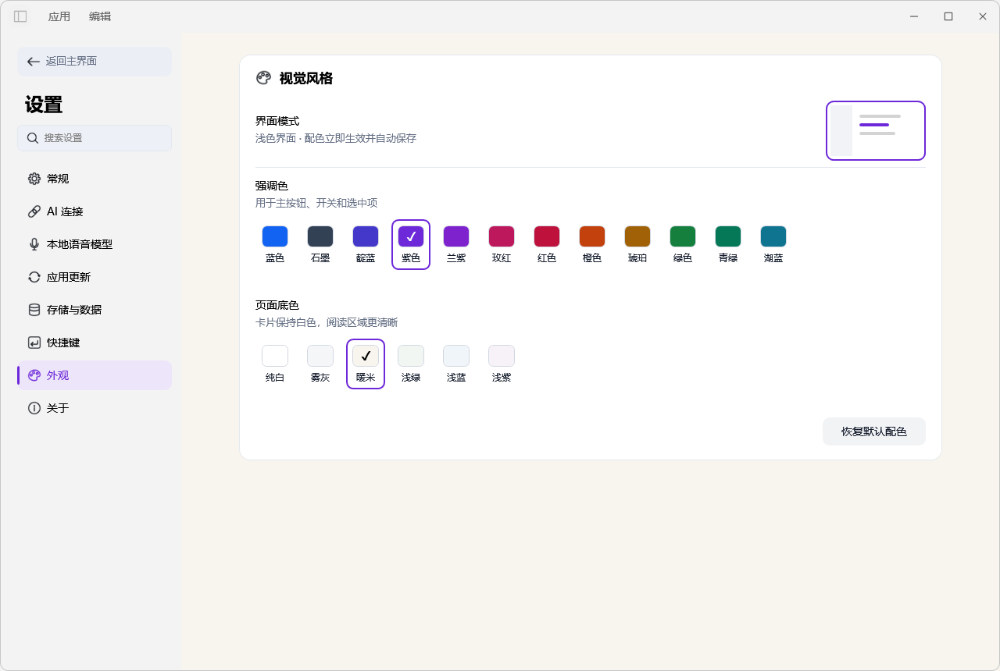
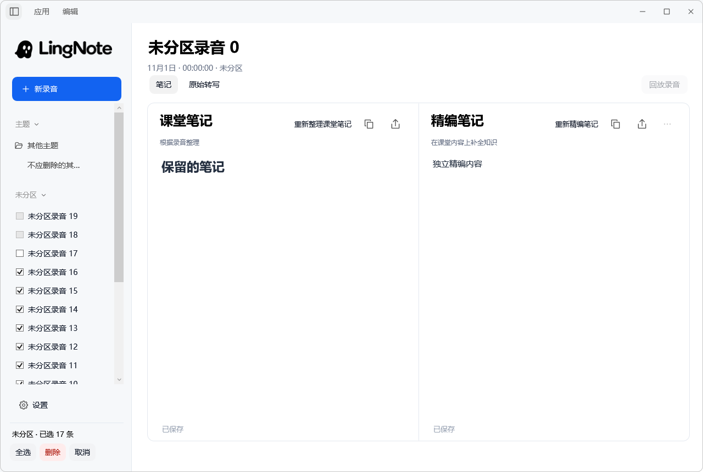

<div align="center">
  
  <h1>LingNote</h1>
  <p><a href="README.md">简体中文</a> · <strong>English</strong></p>
  <p><strong>Turn audio into notes you can revisit.</strong></p>
  <p>System audio recording · Local transcription · AI notes</p>
  <p>
    
    
  </p>
  <p>
    <a href="https://github.com/Bruce-648/LingNote/releases"><strong>Releases</strong></a>
    · <a href="#quick-start">Quick start</a>
    · <a href="assets/RELEASE-NOTES-0.3.0.md">0.3.0 release notes</a>
    · <a href="https://github.com/Bruce-648/LingNote/issues">Report an issue</a>
  </p>
</div>

---

**LingNote** is a lightweight Windows desktop app for recording audio and creating AI notes. Capture audio playing on your computer, transcribe it locally with Whisper, and use your configured AI endpoint to create notes you can edit, copy, and export.

Use it for online courses, lectures, meeting reviews, interviews, podcasts, and livestreams. The current source version is **0.3.0**. The app's interface is primarily in Simplified Chinese; Chinese labels below help you find the corresponding controls.

## Screenshots


<details>
<summary>View recording, settings, appearance, and batch selection</summary>

**Recording controls**


**Settings**


**Appearance**



**Batch selection**



</details>

Screenshots use isolated demo data and contain no personal recordings.

## Features

- **System audio recording**: Pause, resume, and stop recording while continuing to browse previous notes.
- **Independent floating controls**: Control recording while other windows are active or the main window is minimized. Keep the controls on top, drag them, or collapse them into a ghost bubble.
- **Local transcription**: Uses the multilingual Whisper small model. Transcription works offline once the model is ready, and the original transcript and timestamps are retained.
- **Classroom Notes and Refined Notes**: Read both side by side, edit and autosave them independently, copy or export either version, regenerate notes, and restore previous versions.
- **Topic organization**: Expand and collapse folder-style topics, and organize recordings into topics, unassigned entries, and custom sections.
- **Window and region capture**: Take screenshots from the floating controls or with global shortcuts, and assign a screenshot folder to each topic.
- **Batch deletion**: Select recordings within an unassigned list, topic, or section. Select all includes collapsed entries; deletion requires confirmation and protects active tasks.
- **Settings and appearance**: Settings navigation replaces the main sidebar, opens on General, supports search, and restores your previous view on return. Choose from 12 accent colors and 6 light backgrounds.
- **Configurable AI connection**: Set your endpoint, model, and API key, test the connection, and configure request timeout and SSE streaming. General settings contain note mode, thinking mode, and text chunk length.
- **Playback, export, and updates**: Play back recording segments, export Markdown, and check for updates within the app.


## Quick start

1. Get a published installer from **[Releases](https://github.com/Bruce-648/LingNote/releases)**. If you already have a local build, use `artifacts/0.3.0/LingNote-0.3.0-Setup.exe` or run `app/LingNote.exe` directly.
2. Open **Settings (设置) → Local speech model (本地语音模型)** to download or import the multilingual Whisper small model, around **466 MB**. The installer does not include the model; it only needs to be prepared once.
3. Under **Settings (设置) → AI connection (AI 连接)**, enter an OpenAI Chat Completions-compatible endpoint, model name, and API key. Click **Save (保存)** and **Test connection (测试连接)**.
4. Play the content you want to capture. Click **New recording (新录音)**, then **Start recording (开始录音)**.
5. Click **Stop and organize (结束并整理)**, wait for transcription and note generation, then review, edit, or export the result.

Supports **Windows 11 x64**. The installer includes the .NET runtime dependencies; normal use does not require the .NET SDK. Recording and local transcription do not need an API key. AI note generation requires a network connection and a configured service, whose fees depend on your provider.

## Two note modes

Choose a mode under **Settings (设置) → General (常规) → Note mode (笔记模式)**. Changes apply to new recordings; each recording retains its own mode.

| Mode | What happens after recording |
| --- | --- |
| Classroom mode (课堂模式, default) | Generates Classroom Notes first. Generate Refined Notes in the right-hand pane when needed. |
| Refined mode (精编模式) | Generates Refined Notes directly from the transcript and displays them in a single pane, while retaining the audio and original transcript. |

**Classroom Notes (课堂笔记)** organize the recording's content while removing repetition and irrelevant narration. **Refined Notes (精编笔记)** organize knowledge around the topic, rather than retelling the transcript sentence by sentence, and may fill gaps in core knowledge. They can also be shorter. Refinement uses your configured AI service.

Edit note text directly to autosave changes; the original transcript is read-only. In the two-pane view, resize the panes by dragging the divider and scroll each pane independently. Successful regeneration retains the previous version; failed processing preserves existing content.

## Screenshots and save locations

Use the screenshot button on the floating bar to capture a window, or open its menu to select a region. While LingNote is running, these shortcuts are also available:

| Shortcut | Action |
| --- | --- |
| `Ctrl + Shift + 1` | Capture the foreground window |
| `Ctrl + Shift + 2` | Drag to select a screen region |
| `Esc` | Cancel region selection |

Images are saved as PNG files, and the floating bar is hidden before capture. If another app has reserved a shortcut, use the floating bar button.

The save location is resolved in this order:

1. The custom folder assigned to the current recording or note's topic.
2. The default screenshot folder selected under **Settings → Storage and data (存储与数据)**.
3. The `download` folder under the application or project directory, resolved from its location.

Choosing a folder when creating a topic is optional. Use the topic menu to change the folder later or restore the default. Screenshots stay local and are not automatically sent to AI as note attachments.

## Batch recording management

1. Hover over an **Unassigned (未分区)**, topic, or section heading and choose **··· → Batch selection (批量选择)**.
2. Check recordings individually, or use **Select all (全选)** at the bottom of the sidebar. Select all stays within the current scope, including collapsed entries; a section also includes recordings in its topics.
3. Click **Delete (删除)**, review the count and warning, and confirm. Use **Cancel (取消)** or `Esc` to leave selection mode.

Deletion removes the selected records and their notes, transcripts, and audio. **It cannot be undone.** Topics, sections, and expansion states are retained. Recordings being captured or processed cannot be selected, and task status is checked again before deletion.

## Settings and appearance

Settings navigation replaces the main navigation in the same sidebar position, opening on **General (常规)**. Returning restores your notes and list state. Navigation does not stop recording or background processing.

| Category | Controls |
| --- | --- |
| General (常规) | Note mode, thinking mode, and text chunk length |
| AI connection (AI 连接) | Endpoint, model, API key, connection test, timeout, and streaming |
| Local speech model (本地语音模型) | Download or import Whisper small |
| App updates (应用更新) | Installed version, update check, and automatic checks at startup |
| Storage and data (存储与数据) | Open the data folder and set the default screenshot folder |
| Shortcuts (快捷键) | Screenshot shortcut reference |
| Appearance (外观) | 12 accent colors, 6 light backgrounds, and reset to defaults |
| About (关于) | App information and installed version |

Color changes apply immediately, save automatically, and are restored when the app reopens. Cards remain white for readability.

## Usage notes

- LingNote captures audio from the **default system playback device**. It does not directly record your microphone or screen video; the separate screenshot feature saves still images. Your own microphone speech in an online meeting may be missing, while audio from other applications may also be captured.
- Use the floating controls when switching windows or minimizing the app. Stopping a recording returns to the main window. Closing the main window hides the app in the system tray; use the tray menu to reopen it or quit.
- Start another recording while an earlier one is being processed. Recordings and processing results are saved separately.
- Audio is retained if processing fails. Check the speech model or AI configuration, then retry using the note pane's continue, regenerate, or refine action.
- Available thinking options depend on the endpoint and model. The setting is disabled for unsupported models.

## Data and privacy

Audio, transcripts, notes, and settings are stored locally. Installed copies use `%LOCALAPPDATA%\LingNote` by default; existing library bindings continue to use their bound directory. Open **Settings (设置) → Storage and data (存储与数据) → Open data folder (打开数据文件夹)** to find the actual location. Keep and back up this folder when upgrading or moving your data.

Speech transcription runs on your computer. AI generation and refinement send the relevant transcripts, notes, and text context to your configured service. API keys are encrypted with **Windows DPAPI** for the current Windows user. Enter the key again when moving to a different computer or Windows user.

Speech recognition and AI output can contain errors. Refinement uses model knowledge; the app does not automatically retrieve textbooks or independently fact-check results. Verify important terms, numbers, definitions, and conclusions against the recording and reliable sources. Markdown supports tables, lists, code, and readable representations of common formulas; full typesetting for complex LaTeX is not currently supported.

## Development and project structure

Built with **C# / WPF / .NET 10**, NAudio, Whisper.net, Microsoft.Data.Sqlite, and Markdig.

```text
LingNote/
├─ src/LingNote/          # App source, icons, and fonts
├─ tests/LingNote.Tests/  # Automated checks
├─ assets/               # Assets, licenses, model metadata, and release notes
├─ docs/                 # Documentation and screenshots
├─ tools/                # Build and installer scripts
├─ Data/                 # Bound local recording library (not committed)
├─ download/             # Default screenshot output
├─ app/                  # Local runnable build (not committed)
└─ artifacts/0.3.0/       # Current installer and validation output (not committed)
```

See the **[development guide](docs/DEVELOPMENT.md)** for source setup, dependency restore, testing, and packaging. The **[0.3.0 delivery notes](docs/RELEASE-0.3.0.md)** cover local outputs and validation; the **[release notes](assets/RELEASE-NOTES-0.3.0.md)** describe version changes. See the **[batch management guide](docs/BULK-DELETE.md)** for more detail. These documents are in Chinese.

## Feedback and acknowledgments

Submit bugs and suggestions through **[Issues](https://github.com/Bruce-648/LingNote/issues)**. Include the version, reproduction steps, and screenshots with sensitive information removed. Do not submit API keys or private recordings.

Thanks to NAudio, Whisper.net, whisper.cpp, Markdig, and the .NET ecosystem. See **[THIRD-PARTY-NOTICES](assets/THIRD-PARTY-NOTICES.txt)** for third-party components and licenses.
