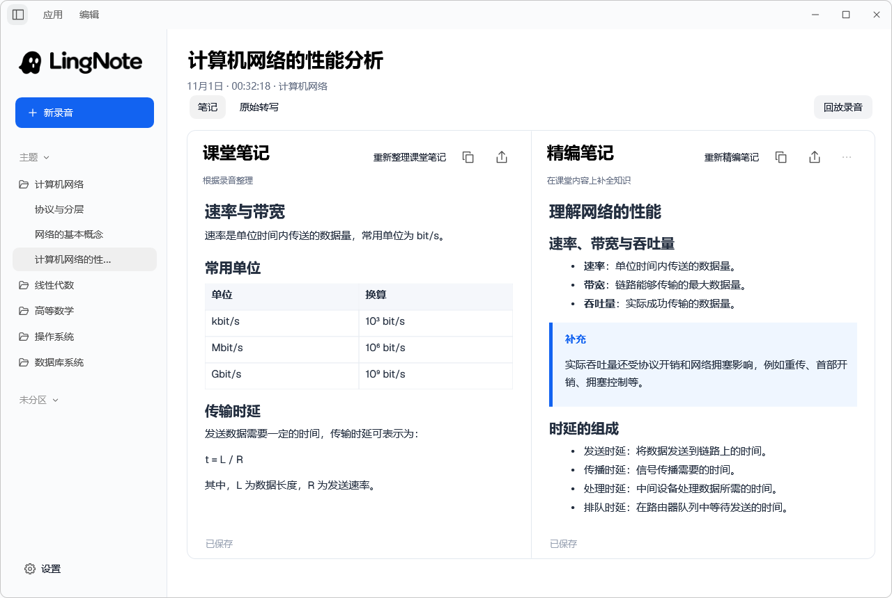
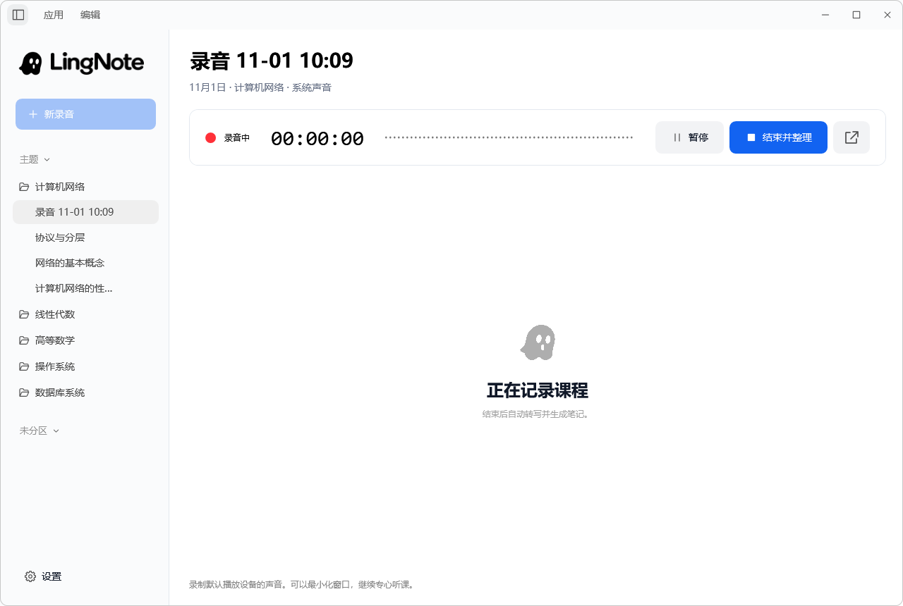
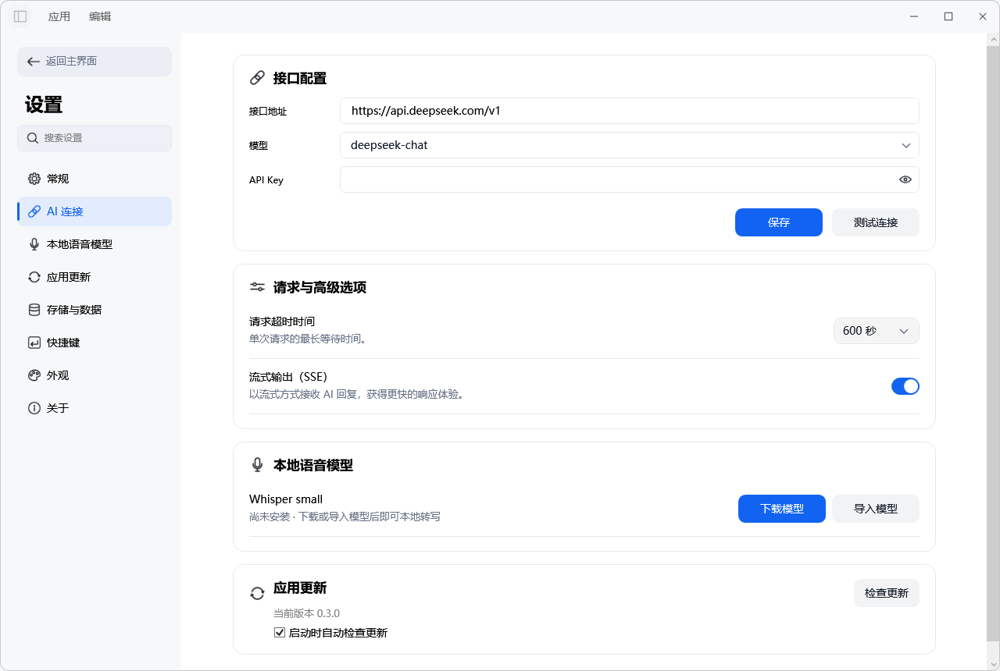

<div align="center">
  
  <h1>LingNote</h1>
  <p><strong>简体中文</strong> · <a href="README.en.md">English</a></p>
  <p><strong>让声音，成为随时可查的笔记。</strong></p>
  <p>系统录音 · 本地转写 · AI 整理</p>
  <p>
    
    
  </p>
  <p>
    <a href="https://github.com/Bruce-648/LingNote/releases"><strong>版本下载</strong></a>
    · <a href="#快速开始">快速开始</a>
    · <a href="assets/RELEASE-NOTES-0.3.0.md">0.3.0 更新说明</a>
    · <a href="https://github.com/Bruce-648/LingNote/issues">反馈问题</a>
  </p>
</div>

---

**LingNote** 是一款轻量的 Windows 桌面录音与 AI 笔记工具。录下电脑播放的声音，在本地用 Whisper 转写，再通过你配置的 AI 接口生成可编辑、复制和导出的笔记。

适合整理线上课程、讲座、会议回顾、访谈、播客和直播。当前源码版本为 **0.3.0**，界面以简体中文为主。

## 界面预览



<details>
<summary>查看录音与设置界面</summary>

**录音控制**



**设置**



</details>

截图使用隔离的演示数据，不包含个人录音。

## 功能特性

- **系统录音**：支持暂停、继续和结束；录音期间仍可浏览历史笔记。
- **独立悬浮控制**：切换窗口或最小化后继续控制录音，支持置顶、拖动，以及收起为幽灵悬浮球。
- **本地语音转写**：使用 Whisper small 多语言模型，模型准备好后可离线转写，保留原始转写文本与时间戳。
- **课堂笔记与精编笔记**：双栏对照阅读，各自编辑、自动保存、复制和导出；支持单独重新整理、重新精编及历史版本恢复。
- **按主题管理**：主题支持文件夹式展开、收起；记录可按主题、未分区和自定义分区组织。
- **截屏与批量管理**：支持窗口/区域截屏、主题自定义保存目录，以及带确认和任务保护的录音批量删除。
- **外观配色**：12种强调色、6种浅色背景，即时生效并自动保存。
- **可配置的 AI 连接**：填写接口地址、模型与 API Key，支持连接测试；高级设置可调整笔记模式、思考模式、流式生成及每段整理字数。
- **回放、导出与更新**：回放录音片段、导出 Markdown，并通过应用内入口检查更新。

## 快速开始

1. 从 **[Releases](https://github.com/Bruce-648/LingNote/releases)** 获取已发布的安装包。已有本地构建时，可使用 `artifacts/0.3.0/LingNote-0.3.0-Setup.exe`，或直接运行 `app/LingNote.exe`。
2. 打开 **设置 → 本地语音模型**，下载或导入 Whisper small 多语言模型，约 **466 MB**。安装包不包含模型，只需准备一次。
3. 在 **设置 → AI 连接** 中填写兼容 OpenAI Chat Completions 的接口地址、模型名称和 API Key，点击「保存」与「测试连接」。
4. 播放需要记录的内容，点击「新录音」，再点击「开始录音」。
5. 点击「结束并整理」，等待转写与笔记生成，再阅读、编辑或导出结果。

支持 **Windows 11 x64**。安装包包含 .NET 运行依赖，普通使用无需安装 .NET SDK。录音和本地转写不需要 API Key；AI 整理需要网络与相应的服务配置，费用由你使用的 AI 服务决定。

## 两种笔记模式

在 **设置 → 高级设置 → 笔记模式** 中选择。修改只影响之后开始的新录音，每条记录保留自己的模式。

| 模式 | 录音结束后的行为 |
| --- | --- |
| 课堂模式（默认） | 先生成课堂笔记，在双栏右侧按需生成精编笔记。 |
| 精编模式 | 直接依据转写生成精编笔记，以单栏展示，同时保留录音与原始转写。 |

**课堂笔记**根据录音内容整理，去除重复和无关叙述。**精编笔记**围绕主题调整结构、详略与表述，并可补充主题内缺少的核心知识，篇幅也可能缩短。精编会额外调用配置的 AI 接口。

笔记正文可直接编辑并自动保存，原始转写页为只读。双栏宽度可拖动调整，两栏独立滚动；重新整理或精编成功后保留上一版，失败时保留原有内容。

## 使用说明

- 录制的是**系统默认播放设备的声音**，不直接采集麦克风，也不录制屏幕。线上会议中你自己的麦克风发言可能不会被录入；其他应用播放的声音也可能被录入。
- 切换窗口或最小化后可使用悬浮控制，结束录音会返回主窗口。关闭主窗口会隐藏到托盘，从托盘菜单可以重新打开或退出。
- 处理上一段录音时可以开始下一段；录音与处理结果分别保存。
- 处理失败时录音仍保留。检查模型或 AI 配置后，可用笔记栏中的继续整理、重新整理或重新精编按钮重试。
- 思考模式的可选项取决于接口和模型；不支持的模型会禁用该设置。

## 数据与隐私

音频、转写、笔记和设置保存在本地。安装版默认数据目录为 `%LOCALAPPDATA%\LingNote`；使用已有数据绑定时，程序会继续使用绑定目录。通过 **设置 → 高级设置 → 打开数据文件夹** 查看实际位置，升级或迁移时请保留并备份该目录。

语音转写在本机执行。AI 整理和精编会将相应的转写、笔记及相关文本上下文发送给你配置的服务。API Key 使用 Windows 当前用户的 **DPAPI** 加密保存，换电脑或 Windows 用户后需要重新填写。

语音识别和 AI 输出可能存在错误。精编内容来自模型知识，程序不会自动检索教材或独立核验事实；重要术语、数字、定义和结论请结合录音及可信资料核对。Markdown 支持表格、列表、代码与常见公式的可读显示，复杂 LaTeX 暂无完整排版支持。

## 开发与项目结构

技术栈：**C# / WPF / .NET 10**，配合 NAudio、Whisper.net、Microsoft.Data.Sqlite 和 Markdig。

```text
LingNote/
├─ src/LingNote/          # 应用源码、图标与字体
├─ tests/LingNote.Tests/  # 自动化检查
├─ assets/               # 资源、许可、模型信息与更新说明
├─ docs/                 # 文档与界面截图
├─ tools/                # 构建与安装脚本
├─ app/                  # 本地可运行程序（不提交）
└─ artifacts/0.3.0/       # 当前安装包与验证记录（不提交）
```

源码运行、依赖恢复、测试及打包步骤见 **[开发文档](docs/DEVELOPMENT.md)**。本地交付与验证结果见 **[0.3.0 交付说明](docs/RELEASE-0.3.0.md)**，版本变化见 **[更新说明](assets/RELEASE-NOTES-0.3.0.md)**。

## 反馈与致谢

问题与建议请提交至 **[Issues](https://github.com/Bruce-648/LingNote/issues)**。反馈时可附版本号、复现步骤和不含敏感信息的截图，请勿提交 API Key 或私人录音。

感谢 NAudio、Whisper.net、whisper.cpp、Markdig 及 .NET 生态。第三方组件与许可见 **[THIRD-PARTY-NOTICES](assets/THIRD-PARTY-NOTICES.txt)**。
